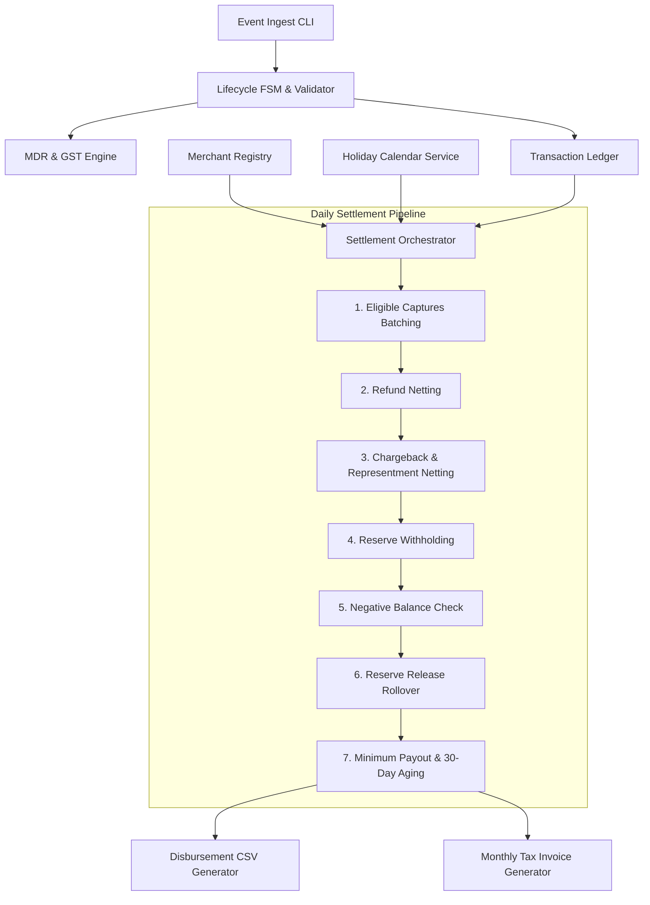
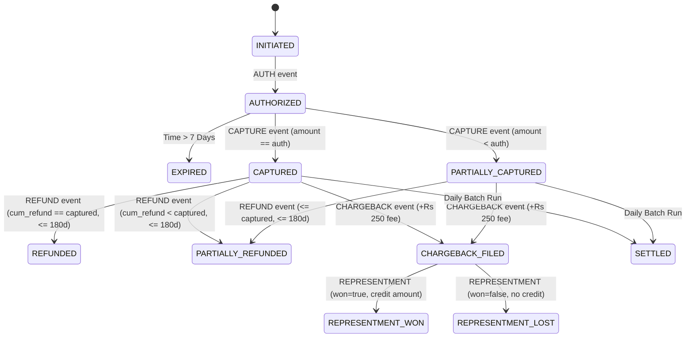

# System Architecture & Technical Design Document
## PS-015 · Payment Aggregator Merchant Settlement with MDR, Holdbacks and Refund Netting
**Team Identifier**: T124-PS-015  
**Domain**: BFSI — Merchant Acquiring, Clearing & Settlement  
**Target Release**: Production-Grade Settlement Engine  

---

## 1. Executive Summary
This document specifies the technical design of the Payment Aggregator Merchant Settlement Engine (`PS-015`). The engine automates the financial lifecycle of payment processing, including:
1. Ingesting transaction lifecycle events (`AUTH`, `CAPTURE`, `REFUND`, `CHARGEBACK`, `REPRESENTMENT`).
2. Computing Merchant Discount Rate (MDR) and Goods & Services Tax (GST) with exact currency precision.
3. Managing multi-tiered risk-based rolling reserves and holdbacks.
4. Netting refunds and chargeback debits against scheduled payouts.
5. Carrying forward negative balances and enforcing minimum payout thresholds.
6. Generating audited daily payout disbursement files and statutory monthly MDR invoices.

---

## 2. System Architecture & Component Interaction

---

## 3. Transaction Lifecycle Finite State Machine (FSM)

The engine enforces strict state transitions compliant with **BR-03** and **BR-11**. Illegal transitions are rejected with clear error codes.

---

## 4. Formal Business Rules Register

| Rule ID | Category | Description | Enforcement Point |
|---|---|---|---|
| **BR-01** | MDR & GST Slabs | UPI 0% up to ₹2,000, 0.3% above; Debit Card 0.4% up to ₹2,000, 0.9% above; Credit Card 1.8%; Net Banking ₹10 flat; Wallet 2.0%; International Card 3.5% + ₹7 flat; GST 18% on MDR. | `mdr_calculator.py` |
| **BR-02** | Plan Overrides | `FLAT_PLAN` charges 1.5% across all instruments except UPI (UPI keeps BR-01). Merchant-specific `negotiated_rate` beats both. | `mdr_calculator.py` |
| **BR-03** | Auth Expiry | AUTH expires if not captured within 7 calendar days ($7 \times 86400\text{ s}$). MDR computed strictly on captured portion. | `lifecycle_validator.py` |
| **BR-04** | Settlement Cycles | LOW risk: T+1 business days; MEDIUM risk: T+2; HIGH risk: T+3. Captures strictly after 23:00 count as next day. Bank holidays and weekends skipped. | `calendar_service.py` |
| **BR-05** | Refund Netting | Allowed within 180 days up to unrefunded capture balance. Aggregator retains original MDR. Net refund deducted from next batch. | `refund_engine.py` |
| **BR-06** | Chargebacks | Debits captured amount + ₹250 penalty fee. If representment won, transaction amount (not fee) is credited back. | `chargeback_engine.py` |
| **BR-07** | Rolling Reserve | HIGH: 10% held for 90 days; MEDIUM: 5% held for 45 days; LOW: 0%. Released on the business day after hold period; holiday/weekend rolls forward. | `reserve_engine.py` |
| **BR-08** | Negative Balance & Minimum Payout | Deficit carried forward with ₹0 payout. Deficit blocks reserve release. Minimum payout ₹100. Payout pending $\ge 30$ days is disbursed in full regardless of minimum. | `payout_calculator.py` |
| **BR-09** | Dynamic Risk | If $\frac{\text{chargebacks in 30d}}{\text{captures in 30d}} > 1.00\%$, risk grade worsens 1 level next day. Recovers after 60 consecutive clean days. | `chargeback_engine.py` |
| **BR-10** | Monthly Invoicing & Pipeline Order | Monthly invoice on 1st of month. Non-GST merchants invoiced inclusive of GST with no ITC line. Strict waterfall execution order. | `invoice_generator.py` |
| **BR-11** | Lifecycle Validation | Rejects illegal transitions: refund before capture, duplicate capture, capture exceeding authorization, chargeback on uncaptured auth. | `lifecycle_validator.py` |

---

## 5. Daily Settlement Waterfall Algorithm

For each merchant on business day $D$:

$$\text{Net Captures} = \sum (\text{Captured Amount}) - \sum (\text{MDR}) - \sum (\text{GST})$$

$$\text{Reserve Withheld} = \text{Net Captures} \times \text{Reserve \%}$$

$$\text{Pre-Release Balance} = \text{Opening Balance} + \text{Net Captures} - \text{Refunds} - \text{Chargeback Debits} + \text{Won Representment Credits} - \text{Reserve Withheld}$$

$$\text{Reserve Released} = 
\begin{cases} 
0, & \text{if } \text{Pre-Release Balance} < 0 \text{ (BR-08 block)} \\
\sum \text{Matured Reserves}, & \text{if } \text{Pre-Release Balance} \ge 0 
\end{cases}$$

$$\text{Calculated Settlement} = \text{Pre-Release Balance} + \text{Reserve Released}$$

$$\text{Actual Payout} = 
\begin{cases} 
0, & \text{if } \text{Calculated Settlement} \le 0 \\
0, & \text{if } 0 < \text{Calculated Settlement} < ₹100 \text{ and } \text{Days Pending} < 30 \\
\text{Calculated Settlement}, & \text{if } 0 < \text{Calculated Settlement} < ₹100 \text{ and } \text{Days Pending} \ge 30 \\
\text{Calculated Settlement}, & \text{if } \text{Calculated Settlement} \ge ₹100
\end{cases}$$

---

## 6. Financial Precision & Mathematical Invariants

1. **Zero-Float Guarantee**: All monetary calculations utilize Python's `decimal.Decimal`. No IEEE 754 floating-point operations are permitted.
2. **Rounding Mode**: `ROUND_HALF_UP` quantized to 2 decimal places (`0.01` paise).
3. **Double-Entry Reconciliation Invariant**:
$$\text{Opening Balance} + \text{Gross Captures} - \text{MDR} - \text{GST} - \text{Refunds} - \text{Net Chargebacks} - \text{Net Reserve Change} = \text{Actual Payout} + \text{Closing Balance}$$

---

## 7. Viva Core Concepts Reference

### Why is MDR not refunded to merchants upon customer refunds?
In card and banking schemes (Visa, Mastercard, RuPay, acquiring banks), payment processing generates immediate interchange and network scheme fees at the moment of authorization/capture. Card schemes **do not refund network interchange** when a merchant initiates a refund. Furthermore, the aggregator incurs bandwidth, fraud screening, and gateway costs to process both the original payment and the refund event. Consequently, market standard (RBI/BFSI guidelines) dictates that the aggregator retains the original MDR.

### How does the rolling reserve release handle holidays?
Under **BR-07**, the release target date is calculated as $\text{Settlement Date} + \text{Hold Days} + 1\text{ Day}$. If this target date falls on a declared bank holiday or a weekend, the engine invokes `CalendarService.roll_to_business_day(date)`, which traverses forward to the immediate next active banking business day. This guarantees funds are disbursed only when the Reserve Bank of India (RBI) NEFT/RTGS settlement rails are operational.
